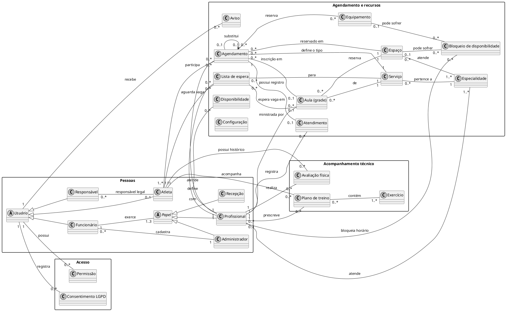

## Diagrama de Classes

### Objetivo

Este diagrama representa os principais conceitos do domínio do PKZ LAB, sistema back-end para apoiar as rotinas de um centro de treinamento. O modelo conceitual organiza os perfis de usuário, os agendamentos e recursos, e o acompanhamento técnico dos atletas, evidenciando seus relacionamentos com base nos requisitos, casos de uso e protótipo. Na seção conceitual, as classes são intencionalmente apresentadas sem atributos e métodos; a seção 3 detalha a visão de especificação conforme o código.

### Componentes do Diagrama de Classes

Este documento define um modelo para:

1. #### Diagrama conceitual

As classes são apresentadas sem atributos e sem métodos. O diagrama contempla os conceitos de pessoas, agendamentos, recursos e acompanhamento técnico identificados nos casos de uso.

(visão de domínio)

2. **Evolução para o Diagrama de Classes de Especificação** (visão de projeto).  

Ambos devem ser derivados de:

- Casos de uso;
- Diagrama de casos de uso;
- Documento de levantamento de requisitos;
- Protótipo de baixa fidelidade.

### Fontes de entrada obrigatórias

- **Levantamento de requisitos**: requisitos funcionais e não funcionais.
- **Casos de uso**: atores, fluxos principal e alternativos.
- **Diagrama de casos de uso**: escopo e fronteiras do sistema.
- **Protótipo de baixa fidelidade**: entidades percebidas na interface e regras de navegação.

### 1) Diagrama de Classes Conceitual

#### 1.1 Finalidade

Identificar e organizar os conceitos do domínio necessários para compreender as funcionalidades descritas nos casos de uso, sem detalhar implementação. O diagrama dá ênfase às associações, às multiplicidades e às generalizações entre perfis.

#### 1.2 Escopo

- Perfis de usuário do centro de treinamento: atleta, responsável, profissional, recepção e administrador;
- Acesso e consentimento relacionados à autenticação, às permissões e ao cadastro;
- Agendamento, disponibilidade, bloqueios, espaços, equipamentos e registro de atendimento;
- Acompanhamento técnico do atleta por avaliações físicas, planos de treino e exercícios;
- Associações, multiplicidades e generalizações necessárias para expressar os vínculos do domínio.

O escopo não inclui componentes técnicos da API, como telas, endpoints, controladores ou repositórios.

#### 1.3 Notação mínima

O diagrama utiliza notação UML e segue estas regras:

- Cada classe contém somente seu nome; não são incluídos atributos nem métodos;
- Associações representam vínculos identificados nos casos de uso e no domínio do projeto;
- Multiplicidades indicam quantas instâncias podem participar de cada associação;
- Generalizações são usadas para representar especializações de perfis quando aplicável;
- Não são incluídos detalhes de implementação nem classes técnicas.

#### 1.4 Rastreabilidade

A tabela relaciona cada classe aos requisitos do Brainstorm (`BS`), aos casos de uso (`UC`) e às telas do Protótipo de Baixa Fidelidade que fornecem evidência para o conceito. Quando o protótipo não apresenta uma tela para determinada classe, isso é indicado explicitamente.

| Classe Conceitual | Requisito(s) | Caso(s) de Uso | Tela/Protótipo |
|---|---|---|---|
| Usuário | BS12, BS13 | UC01, UC02, UC03, UC04, UC16 | Tela 1 — Login; Tela 1b — Cadastro |
| Funcionário | BS02, BS12, BS14 | UC04, UC16 | Tela 1 — Login; cadastro da equipe pelo administrador (não detalhado no protótipo) |
| Papel (abstrata) | BS02, BS12 | UC04, UC16 | Define as permissões de cada função (Profissional, Recepção, Administrador) |
| Atleta | BS01, BS05, BS06, BS07, BS11 | UC02, UC06, UC07, UC08, UC09, UC10, UC12, UC14 | Tela 1b — Cadastro; Tela 2 — Informações de agendamento; Tela 5 — Minha agenda |
| Responsável | BS01, BS12, BS13 | UC02, UC06, UC08, UC09, UC10, UC14 | Tela 1b — Cadastro; Tela 2 — Informações de agendamento; Tela 5 — Minha agenda |
| Profissional | BS02, BS06, BS07, BS08, BS09, BS10, BS11, BS15 | UC04, UC05, UC06, UC07, UC08, UC09, UC10, UC11, UC12, UC13, UC14, UC15 | Tela 1 — Login; Tela 2 — Informações de agendamento; Tela 5 — Minha agenda; Tela 6 — Registro de status do atendimento |
| Recepção | BS05, BS11, BS12 | UC01, UC03, UC04, UC06, UC08, UC09, UC10 | Tela 1 — Login; Tela 2 — Informações de agendamento; Tela 5 — Minha agenda |
| Administrador | BS12, BS13, BS14 | UC01, UC03, UC04, UC06, UC08, UC09, UC10, UC11, UC15, UC16, UC17, UC18 | Tela 1 — Login; demais telas administrativas não detalhadas no protótipo |
| Permissão | BS12, BS13 | UC01, UC04, UC16 | Tela 1 — Login; Tela 1b — Cadastro |
| Consentimento LGPD | BS13 | UC02 | Tela 1b — Cadastro |
| Agendamento | BS05, BS06, BS10, BS11, BS14 | UC06, UC07, UC08, UC09, UC10, UC11 | Tela 2 — Informações de agendamento; Tela 3 — Verificação de disponibilidade; Tela 4 — Confirmação do agendamento; Tela 5 — Minha agenda; Tela 6 — Registro de status do atendimento |
| Disponibilidade | BS06 | UC05, UC07, UC17 | Tela 2 — Informações de agendamento; Tela 3 — Verificação de disponibilidade |
| Bloqueio de disponibilidade | BS06, BS14 | UC05, UC07, UC17 | Tela 3 — Verificação de disponibilidade; gestão de bloqueios não detalhada no protótipo |
| Espaço | BS06, BS14 | UC06, UC07, UC17 | Tela 2 — Informações de agendamento; Tela 3 — Verificação de disponibilidade |
| Serviço | BS05, BS14 | UC06, UC18 | Tela 2 — Informações de agendamento |
| Especialidade | BS02, BS05 | UC04, UC18 | Tela 2 — Informações de agendamento |
| Lista de espera | BS05, BS06, BS14 | UC09, UC19 | Tela 2 — Informações de agendamento (horário em cinza) |
| Aviso | BS11, BS15 | UC19, UC20 | Agenda (quadro de avisos) e e-mail |
| Aula (grade) | BS05, BS06, BS14 | UC06, UC19, UC21 | Tela 2 — Informações de agendamento (aulas do dia com vagas) |
| Configuração | BS14 | UC19 | Painel do administrador (prazo para confirmar a vaga) |
| Equipamento | BS06, BS14 | UC06, UC07, UC17 | Tela 2 — Informações de agendamento; Tela 3 — Verificação de disponibilidade |
| Atendimento | BS08, BS10, BS15 | UC11, UC14, UC15 | Tela 6 — Registro de status do atendimento |
| Avaliação física | BS03, BS07, BS09 | UC12, UC14, UC15 | Não detalhada no protótipo |
| Plano de treino | BS04, BS07, BS09 | UC13, UC14, UC15 | Não detalhada no protótipo |
| Exercício | BS04 | UC13 | Não detalhada no protótipo |

#### 1.5 Critérios de validação

- Cada classe deve corresponder a um conceito do domínio e estar ligada a pelo menos um requisito ou caso de uso;
- As classes devem conter somente seus nomes, sem atributos ou métodos;
- Os relacionamentos, multiplicidades e generalizações devem ser compatíveis com os fluxos e regras descritos nos documentos do projeto;
- Os nomes devem manter a terminologia usada nos casos de uso e no protótipo;
- Não devem ser incluídas classes técnicas nem conceitos fora do escopo do PKZ LAB;
- Cada linha de rastreabilidade deve apontar para referências existentes; a ausência de tela no protótipo deve ser identificada, não presumida.

### 2) Transição para Diagrama de Classes de Especificação

#### 2.1 Objetivo
Refinar o modelo conceitual para uma estrutura orientada à implementação.

#### 2.2 Regras de refinamento

- Converter conceitos em classes de software quando aplicável;
- Definir tipos de atributos e visibilidade;
- Incluir operações principais;
- Aplicar estereótipos quando necessário (ex.: `<<entity>>`, `<<service>>`, `<<boundary>>`);
- Preservar rastreabilidade com requisitos e casos de uso.

#### 2.3 Itens esperados por classe

- **Nome da classe**;
- **Atributos** (`nome: tipo [visibilidade]`);
- **Métodos/operações** (`assinatura`);
- **Responsabilidade**;
- **Dependências e associações**;
- **Restrições/invariantes** (quando houver).

### 3) Diagrama de Classes de Especificação

#### 3.1 Modelo e responsabilidades

O diagrama a seguir refina o domínio conceitual conforme os modelos Django dos apps `pessoas`, `estrutura`, `agenda` e `acompanhamento`. A classe `Usuario` representa o `django.contrib.auth.models.User`, externo ao app Pessoas. `Grupo` representa os grupos de permissões do Django associados aos papéis ativos; `Permissão` é uma permissão do framework, não uma tabela própria do domínio. Os tipos indicados são tipos de domínio/Python (`str`, `int`, `bool`, `date`, `datetime`, `time`, `Decimal`); `FK`, `O2O` e `M2M` identificam a cardinalidade persistida.

```plantuml
@startuml
skinparam packageStyle rectangle
skinparam monochrome true
skinparam shadowing false
hide empty members

package "pessoas" {
  class "Usuario\n<<Django>>" as Usuario {
    +username: str
    +email: str
    +first_name: str
    +last_name: str
    +is_active: bool
    +is_staff: bool
    +is_superuser: bool
    +groups: M2M[Grupo]
    +has_perm(codename: str): bool
  }
  class "Grupo\n<<Django>>" as Grupo {
    +name: str
    +permissions: M2M[Permissao]
  }
  class "Permissão\n<<Django>>" as Permissao {
    +codename: str
    +name: str
  }
  class Funcionario {
    +matricula: str
    +data_admissao: date
    +nome: str {property}
    +ativo: bool {property}
    +__str__(): str
  }
  abstract class Papel {
    +ativo: bool
    +nome: str {property}
    +__str__(): str
  }
  class Profissional {
    +especialidades: M2M[Especialidade]
    +ativos(): QuerySet[Profissional]
    +atende(especialidade: Especialidade): bool
  }
  class Recepcao
  class Administrador
  class Atleta {
    +data_nascimento: date
    +responsavel: FK[Responsavel]?
    +nome: str {property}
    +email: str {property}
    +idade: int {property}
    +menor_de_idade: bool {property}
    +clean(): None
    +save(*args, **kwargs): None
    +__str__(): str
  }
  class Responsavel {
    +cpf: str
    +telefone: str
    +nome: str {property}
    +email: str {property}
    +__str__(): str
  }
  class ConsentimentoLGPD {
    +data: datetime
    +versao_termos: str
    +__str__(): str
  }
}

package "estrutura" {
  class Especialidade {
    +nome: str
    +ativo: bool
    +__str__(): str
  }
  class Espaco {
    +nome: str
    +capacidade: int
    +ativo: bool
    +__str__(): str
  }
  class Servico {
    +nome: str
    +duracao_minutos: int
    +vagas: int
    +ativo: bool
    +em_grupo: bool {property}
    +duracao: timedelta {property}
    +espacos_possiveis(): QuerySet[Espaco]
    +__str__(): str
  }
  class Equipamento {
    +nome: str
    +quantidade: int
    +ativo: bool
    +__str__(): str
  }
  class Configuracao {
    +prazo_confirmacao_horas: int
    +confirmar_ate_minutos_antes: int
    +atual(): Configuracao
    +prazo_para_confirmar(inicio: datetime, agora: datetime?): datetime
    +__str__(): str
  }
}

package "agenda" {
  class Agendamento {
    +protocolo: str
    +inicio: datetime
    +fim: datetime
    +status: StatusAgendamento
    +justificativa: str
    +criado_em: datetime
    +lembrete_enviado_em: datetime?
    +clean(): None
    +save(*args, **kwargs): None
    +reservar_equipamentos(equipamentos: Iterable[Equipamento]): None
    +cancelar(justificativa: str): None
    +reagendar(novo_inicio: datetime): Agendamento
    +quem_recebe_avisos(): list[Usuario]
    +enviar_lembrete(): None
    +precisam_de_lembrete(agora: datetime?): QuerySet[Agendamento]
    +enviar_lembretes(agora: datetime?): int
  }
  class Aula {
    +dia: date
    +hora_inicio: time
    +hora_fim: time
    +ativo: bool
    +criado_em: datetime
    +inicio: datetime {property}
    +fim: datetime {property}
    +vagas_restantes: int {property}
    +lotada: bool {property}
    +clean(): None
    +save(*args, **kwargs): None
    +__str__(): str
  }
  class Inscricao {
    +status: StatusInscricao
    +criado_em: datetime
    +clean(): None
    +__str__(): str
  }
  class ListaEspera {
    +inicio: datetime
    +status: StatusListaEspera
    +prazo: datetime?
    +criado_em: datetime
    +mesma_fila(): QuerySet[ListaEspera]
    +posicao: int? {property}
    +clean(agora: datetime?): None
    +atleta_ocupado(): bool
    +oferecer_vaga(vaga: Agendamento, agora: datetime?): ListaEspera?
    +descricao(): str
    +avisar(texto: str): None
    +confirmar(agora: datetime?): Agendamento
    +recusar(agora: datetime?): None
    +sair(agora: datetime?): None
    +vencer_ofertas(agora: datetime?): int
    +__str__(): str
  }
  class Aviso {
    +texto: str
    +link: str
    +lido: bool
    +criado_em: datetime
    +avisar(usuario: Usuario, texto: str, link: str): Aviso
    +marcar_como_lido(): None
    +__str__(): str
  }
  class Disponibilidade {
    +dia_da_semana: int
    +hora_inicio: time
    +hora_fim: time
    +clean(): None
    +__str__(): str
  }
  class Bloqueio {
    +inicio: datetime
    +fim: datetime
    +motivo: str
    +criado_em: datetime
    +alvo: Profissional | Espaco | Equipamento {property}
    +clean(): None
    +agendamentos_afetados(): QuerySet[Agendamento]
    +__str__(): str
  }
  class Atendimento {
    +status: StatusAtendimento
    +justificativa: str
    +registrado_em: datetime
    +clean(agora: datetime?): None
    +registrar(agendamento: Agendamento, status: StatusAtendimento, autor: Usuario, justificativa: str, agora: datetime?): Atendimento
    +__str__(): str
  }
}

package "acompanhamento" {
  class AvaliacaoFisica {
    +data: date
    +velocidade: Decimal?
    +forca: Decimal?
    +resistencia: Decimal?
    +agilidade: Decimal?
    +observacoes: str
    +criado_em: datetime
    +clean(): None
    +anterior(): AvaliacaoFisica?
    +comparacao(): dict[str, Decimal | None]?
    +__str__(): str
  }
  class Exercicio {
    +nome: str
    +descricao: str
    +ativo: bool
    +__str__(): str
  }
  class PlanoTreino {
    +objetivo: str
    +frequencia_semanal: int
    +inicio: date
    +fim: date?
    +observacoes: str
    +versao: int
    +ativo: bool
    +criado_em: datetime
    +clean(): None
    +prescrever(atleta: Atleta, profissional: Profissional, itens: list[dict], **dados): PlanoTreino
    +__str__(): str
  }
  class ItemDoPlano {
    +ordem: int
    +series: int
    +repeticoes: int
    +carga: str
    +__str__(): str
  }
}

package "Interfaces REST (Django REST Framework)" {
  class AgendamentoViewSet <<boundary>> {
    +cancelar(request, pk): Response
    +reagendar(request, pk): Response
    +registrar_atendimento(request, pk): Response
  }
  class AvisoViewSet <<boundary>> {
    +lido(request, pk): Response
  }
  class AvaliacaoFisicaViewSet <<boundary>>
  class PlanoTreinoViewSet <<boundary>>
  class ExercicioViewSet <<boundary>>
}

Papel <|-- Profissional
Papel <|-- Recepcao
Papel <|-- Administrador
Usuario "1" -- "0..1" Funcionario : login
Usuario "1" -- "0..1" Atleta : login
Usuario "1" -- "0..1" Responsavel : login
Funcionario "1" -- "0..3" Papel : exerce
Usuario "0..*" -- "0..*" Grupo : pertence a
Grupo "0..*" -- "0..*" Permissao : concede
Usuario "1" -- "0..*" ConsentimentoLGPD : registra
Responsavel "0..1" -- "0..*" Atleta : responsavel legal
Profissional "0..*" -- "0..*" Especialidade : atende
Espaco "0..*" -- "0..*" Especialidade : atende
Servico "0..*" --> "1" Especialidade : classificado por
Servico "0..*" -- "0..*" Espaco : restringe (opcional)
Atleta "1" -- "0..*" Agendamento : agenda
Profissional "1" -- "0..*" Agendamento : atende
Espaco "1" -- "0..*" Agendamento : reservado em
Servico "1" -- "0..*" Agendamento : define
Aula "0..1" -- "0..*" Agendamento : agrupa
Aula "0..*" --> "1" Servico : oferece
Aula "0..*" --> "1" Profissional : ministrada por
Aula "0..*" --> "1" Espaco : ocorre em
Atleta "1" -- "0..*" Inscricao : participa
Aula "1" -- "0..*" Inscricao : recebe
Agendamento "0..1" -- "0..1" Inscricao : vincula
Atleta "1" -- "0..*" ListaEspera : aguarda
Servico "1" -- "0..*" ListaEspera : solicitado
Profissional "1" -- "0..*" ListaEspera : solicitado
Aula "0..1" -- "0..*" ListaEspera : fila da turma
Agendamento "0..1" <-- "0..*" ListaEspera : vaga oferecida
Agendamento "0..1" <-- "0..1" ListaEspera : agendamento confirmado
Usuario "1" -- "0..*" Aviso : recebe
Profissional "1" -- "0..*" Disponibilidade : define
Profissional "0..1" -- "0..*" Bloqueio : bloqueia
Espaco "0..1" -- "0..*" Bloqueio : pode sofrer
Equipamento "0..1" -- "0..*" Bloqueio : pode sofrer
Agendamento "0..*" -- "0..*" Equipamento : reserva
Agendamento "1" -- "0..1" Atendimento : registra resultado
Usuario "1" -- "0..*" Atendimento : registra
Atleta "1" -- "0..*" AvaliacaoFisica : avaliado
Profissional "1" -- "0..*" AvaliacaoFisica : realiza
Atleta "1" -- "0..*" PlanoTreino : recebe
Profissional "1" -- "0..*" PlanoTreino : prescreve
PlanoTreino "1" *-- "1..*" ItemDoPlano : composição
ItemDoPlano "0..*" --> "1" Exercicio : descreve
PlanoTreino "0..1" <-- "0..1" PlanoTreino : substitui
Agendamento "0..1" <-- "0..1" Agendamento : substitui

AgendamentoViewSet ..> Agendamento
AgendamentoViewSet ..> Atendimento
AvisoViewSet ..> Aviso
AvaliacaoFisicaViewSet ..> AvaliacaoFisica
PlanoTreinoViewSet ..> PlanoTreino
ExercicioViewSet ..> Exercicio
@enduml
```

**Tipos e regras de implementação:** `StatusAgendamento`, `StatusInscricao`, `StatusListaEspera` e `StatusAtendimento` são escolhas (`TextChoices`) definidas nos respectivos modelos; não são entidades. `fim` do agendamento é calculado a partir de `inicio` e da duração do serviço. `Aula.inicio` e `Aula.fim` também são propriedades calculadas. O fim nullable de um ciclo de treino, o responsável do atleta e os vínculos de aula/lista de espera são opcionais. `ItemDoPlano` é a entidade associativa do relacionamento N:N entre plano e exercício; cada plano guarda sua composição e versões anteriores não são apagadas.

**Associações e invariantes relevantes:** o funcionário pode exercer zero ou mais papéis, no máximo um de cada tipo, e papéis ativos sincronizam os grupos e permissões Django. Um serviço pertence a uma especialidade e pode restringir opcionalmente os espaços disponíveis. A lista de espera é para um serviço/profissional/horário ou para uma aula; uma oferta referencia a vaga que a originou e pode criar um agendamento confirmado. Cada atendimento pertence a um único agendamento e é registrado por um usuário. Bloqueio tem exatamente um alvo entre profissional, espaço e equipamento. Um plano contém ao menos um `ItemDoPlano`; uma nova prescrição pode substituir a versão ativa. As interfaces REST são camadas de entrada e delegam regras e persistência às entidades/serviços dos modelos.

#### 3.2 Rastreabilidade

Os requisitos abaixo usam os identificadores RF01–RF22 do Levantamento de Requisitos. A origem conceitual segue as classes e associações da seção 1; mais de uma classe pode realizar o mesmo requisito.

| Classe de Especificação | Origem Conceitual | Requisito(s) | Caso(s) de Uso |
|---|---|---|---|
| Usuario (Django User) | Usuário | RF01, RF02, RF03, RF04, RF16 | UC01, UC02, UC03, UC04, UC16 |
| Grupo e Permissão (Django Auth) | Permissão | RF01, RF04, RF16 | UC01, UC04, UC16 |
| Funcionario | Funcionário | RF04, RF16 | UC04, UC16 |
| Papel (abstrata) | Papel | RF04, RF16 | UC04, UC16 |
| Profissional | Profissional | RF04, RF05, RF06, RF11, RF12, RF13, RF15, RF16 | UC04, UC05, UC06, UC11, UC12, UC13, UC15, UC16 |
| Recepcao | Recepção | RF04, RF06, RF08, RF09, RF10, RF16 | UC04, UC06, UC08, UC09, UC10, UC16 |
| Administrador | Administrador | RF04, RF16, RF17, RF19, RF22 | UC04, UC16, UC17, UC18, UC21 |
| Atleta | Atleta | RF02, RF06, RF08, RF09, RF10, RF11, RF12, RF13, RF14, RF15, RF20, RF21 | UC02, UC06, UC08, UC09, UC10, UC11, UC12, UC13, UC14, UC15, UC19, UC20 |
| Responsavel | Responsável | RF02, RF06, RF08, RF09, RF10, RF14, RF21 | UC02, UC06, UC08, UC09, UC10, UC14, UC20 |
| ConsentimentoLGPD | Consentimento LGPD | RF02 | UC02 |
| Especialidade | Especialidade | RF04, RF17, RF19 | UC04, UC17, UC18 |
| Espaco | Espaço | RF06, RF07, RF17, RF22 | UC06, UC07, UC17, UC21 |
| Servico | Serviço | RF06, RF07, RF19, RF20, RF22 | UC06, UC07, UC18, UC19, UC21 |
| Equipamento | Equipamento | RF06, RF07, RF17 | UC06, UC07, UC17 |
| Configuracao | Configuração | RF20 | UC19 |
| Agendamento | Agendamento | RF06, RF07, RF08, RF09, RF10, RF11, RF20, RF21, RF22 | UC06, UC07, UC08, UC09, UC10, UC11, UC19, UC20, UC21 |
| Aula | Aula (grade) | RF06, RF07, RF20, RF22 | UC06, UC07, UC19, UC21 |
| Inscricao | Agendamento / Aula | RF06, RF10, RF22 | UC06, UC10, UC21 |
| ListaEspera | Lista de espera | RF20, RF21 | UC19, UC20 |
| Aviso | Aviso | RF21 | UC20 |
| Disponibilidade | Disponibilidade | RF05, RF06, RF07 | UC05, UC06, UC07 |
| Bloqueio | Bloqueio de disponibilidade | RF05, RF07, RF17 | UC05, UC07, UC17 |
| Atendimento | Atendimento | RF11, RF14, RF15 | UC11, UC14, UC15 |
| AvaliacaoFisica | Avaliação física | RF12, RF14, RF15 | UC12, UC14, UC15 |
| PlanoTreino | Plano de treino | RF13, RF14, RF15 | UC13, UC14, UC15 |
| ItemDoPlano | Plano de treino / Exercício | RF13 | UC13 |
| Exercicio | Exercício | RF13 | UC13 |
| AgendamentoViewSet | Agendamento / Atendimento | RF06, RF08, RF09, RF10, RF11 | UC06, UC08, UC09, UC10, UC11 |
| AvisoViewSet | Aviso | RF21 | UC20 |
| AvaliacaoFisicaViewSet | Avaliação física | RF12, RF15 | UC12, UC15 |
| PlanoTreinoViewSet | Plano de treino | RF13 | UC13 |
| ExercicioViewSet | Exercício | RF13 | UC13 |

#### 3.3 Critérios de qualidade

- Os nomes, atributos, tipos e operações do diagrama correspondem aos modelos e interfaces REST implementados; propriedades e valores derivados estão identificados como tais.
- As associações registram os vínculos reais, inclusive o modelo associativo `ItemDoPlano`, a referência de uma oferta à vaga original e o autor usuário do atendimento.
- As multiplicidades distinguem vínculos obrigatórios, opcionais, um-para-um e muitos-para-muitos; campos nullable estão marcados com `?`.
- Os requisitos RF18 (integração financeira futura) e RF não relacionado a uma classe persistida não geram entidades fictícias no modelo.
- A tabela liga cada classe de especificação a uma classe conceitual e aos RF/UC existentes, permitindo rastrear as responsabilidades até o requisito.

### 4) Estrutura de versionamento e revisão

- **Versão**: `v0.1`
- **Data**: `25/09/2026`
- **Autor(es)**: Gabriel de Souza, Vitor Luiz Zanconato, Vitor Magalhães e Filipe Andrade
- **Revisor(es)**: Gabriel de Souza, Vitor Luiz Zanconato, Vitor Magalhães e Filipe Andrade
- **Resumo da alteração**: Inclusão do Diagrama de Classes Conceitual, com classes vazias e relacionamentos derivados dos Casos de uso, Documento de Levantamento de Requisitos e Protótipo de Baixa fidelidade do PKZ LAB.

### 5) Entregáveis

- Diagrama de Classes Conceitual (imagem + fonte);
- Diagrama de Classes de Especificação (imagem + fonte);
- Tabelas de rastreabilidade preenchidas;
- Registro de validação com equipe e stakeholders.

## Organização do código em apps (Django)

As classes foram divididas em quatro apps do Django, um por assunto. Cada app reúne só o que tem a ver com ele (alta coesão) e a dependência entre eles vai num sentido só: <b>acompanhamento</b> usa <b>pessoas</b> e <b>agenda</b>, <b>agenda</b> usa <b>pessoas</b> e <b>estrutura</b>, <b>pessoas</b> usa <b>estrutura</b>, e o contrário nunca acontece (baixo acoplamento). Assim cada integrante pode trabalhar num app sem mexer no código dos outros, e os testes de cada parte rodam separados.

| App | Classes | O que faz |
| -- | -- | -- |
| <b>estrutura</b> | Especialidade, Espaço, Serviço, <b>Equipamento</b>, Configuração | O que o CT oferece e onde: salas ligadas às especialidades, modalidades com duração e vagas, equipamentos com quantidade e disponibilidade, e ajustes do administrador |
| <b>pessoas</b> | Funcionário, Papel (abstrata), Profissional, Recepção, Administrador, Atleta, Responsável, Consentimento LGPD | Quem é quem: um login e uma matrícula por pessoa, papéis que se acumulam e definem as permissões |
| <b>agenda</b> | Disponibilidade, Bloqueio, Aula (grade), Agendamento, <b>Atendimento</b>, Lista de espera, Aviso | O dia a dia: horários livres e bloqueios, aulas e agendamentos, registro do resultado do atendimento, lista de espera com confirmação, avisos e lembretes |
| <b>acompanhamento</b> | <b>Avaliação física</b>, <b>Exercício</b>, <b>Plano de treino</b>, Item do plano | O acompanhamento técnico do atleta: avaliações com resultados comparáveis, exercícios e planos compostos com histórico de versões |

A classe <b>Papel</b> é abstrata: não vira tabela, só reúne o que todo papel tem em comum. O <b>Usuário</b> do diagrama corresponde ao login do próprio Django; no código, cada perfil se liga a ele por uma associação 1 para 1, o que permite que a mesma pessoa tenha mais de um papel (por exemplo, a coordenadora que também atende como fisioterapeuta).

