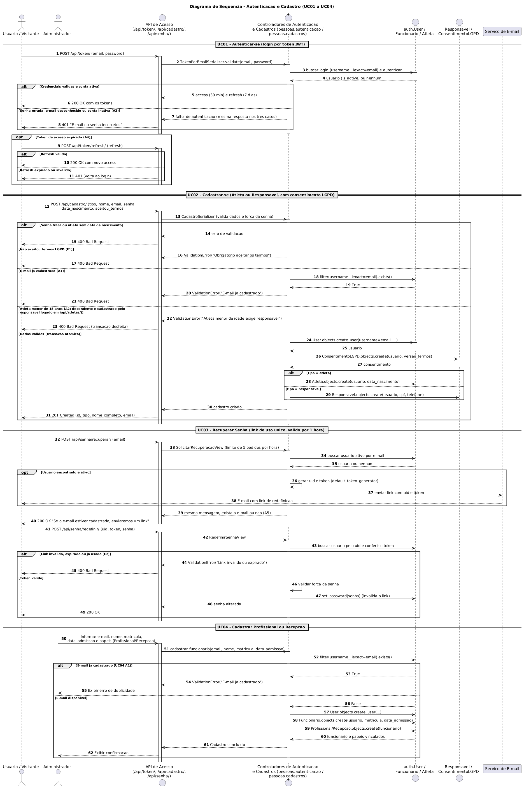
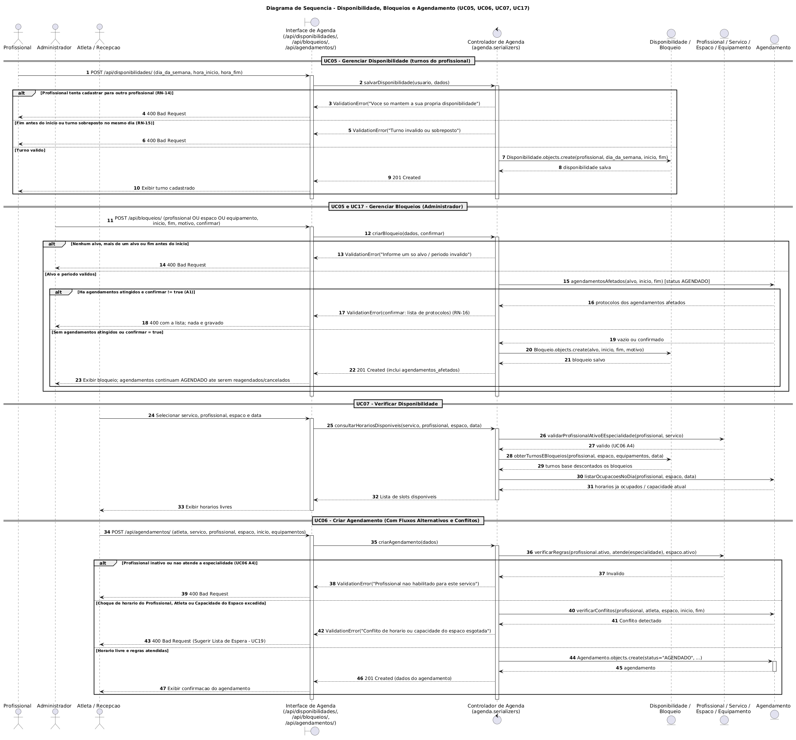
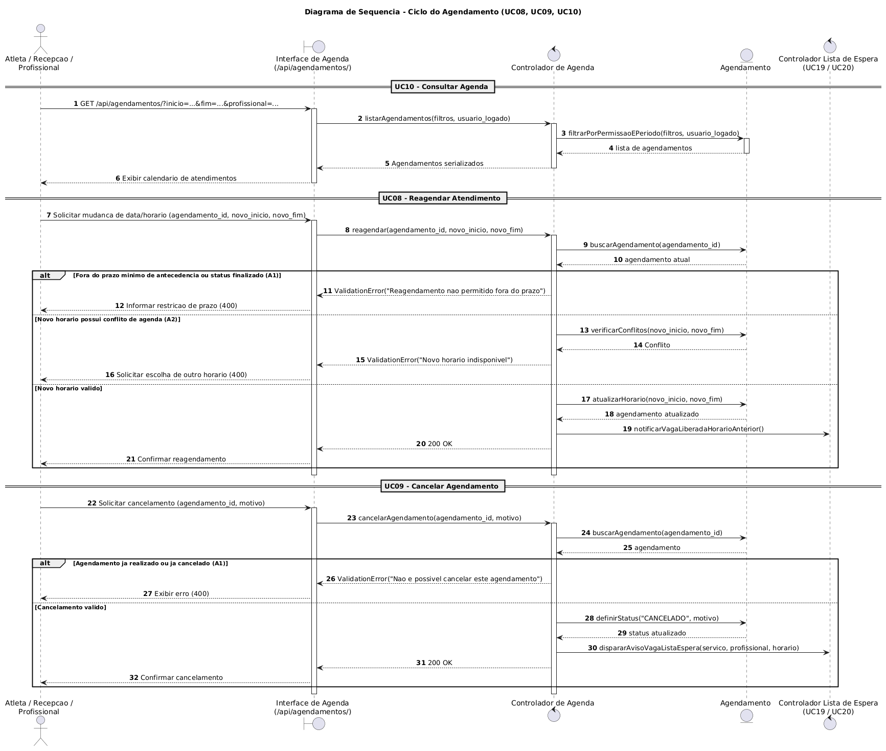
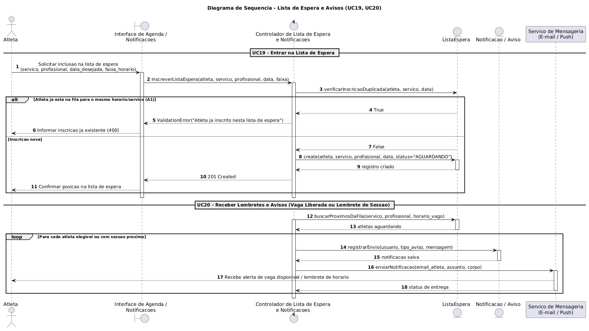
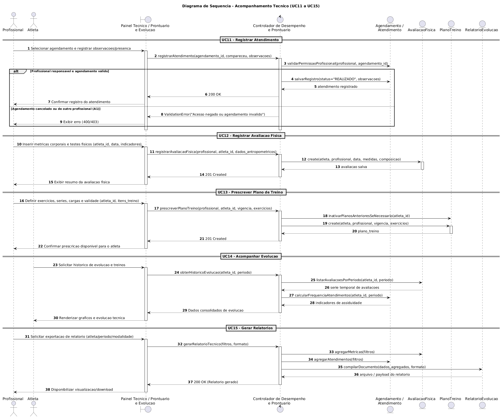
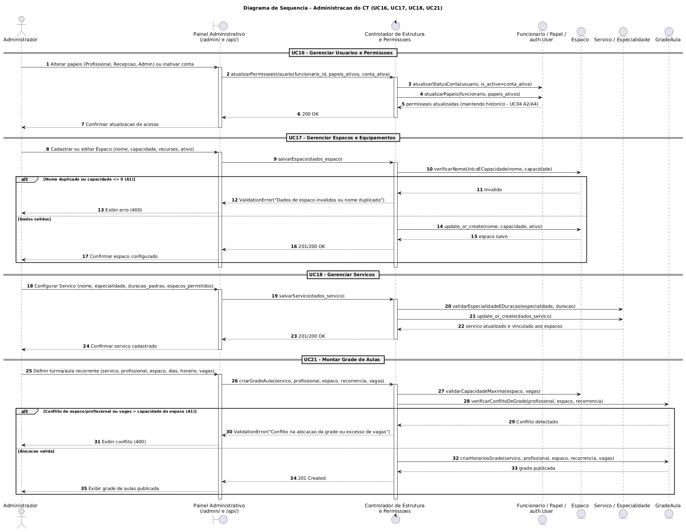

### Diagrama de Sequência

O Diagrama de Sequência é uma representação visual que mostra a interação entre objetos ou componentes ao longo do tempo. Ele é usado para modelar o comportamento dinâmico do sistema **PKZ LAB**, ilustrando como fronteiras (views/telas), controladores (serviços/regras de negócio) e entidades (models) colaboram para realizar cada funcionalidade específica.

#### Objetivo

Definir um padrão para elaboração e registro dos Diagramas de Sequência, garantindo rastreabilidade com:

- Casos de Uso (`UC01` a `UC21`)
- Diagrama de Casos de Uso
- Documento de Levantamento de Requisitos
- Protótipo de Baixa Fidelidade

---

### 1. Autenticação e Cadastro (UC01, UC02, UC03, UC04)

##### 1.1 Identificação

- **Caso de Uso:** Autenticar-se, Cadastrar-se, Recuperar senha e Cadastrar profissional ou recepção
- **ID do Caso de Uso:** UC01, UC02, UC03, UC04
- **Ator(es):** Visitante / Atleta, Usuário Cadastrado e Administrador
- **Prioridade:** Alta
- **Responsável:** Equipe PKZ LAB
- **Data:** 03/11/2026

##### 1.2 Referências

- **Requisitos relacionados (ID):** RF01, RF02, RF03, RF04, RNF-LGPD
- **Diagrama de Caso de Uso (link/imagem):** [Casos de Uso](./casos_de_uso.md)
- **Protótipo de Baixa Fidelidade (tela/fluxo):** Telas de Login, Autocadastro de Atleta, Recuperação de Senha e Cadastro de Equipe
- **Regra(s) de negócio associada(s):** E-mail único como login (`UC04 A1`), obrigatoriedade de responsável para menor de 18 anos (`UC02`), registro de consentimento LGPD com versão dos termos (`UC02`) e acúmulo de papéis sob a mesma matrícula (`UC04 A3`).

##### 1.3 Cenário Modelado

- **Objetivo do cenário:** Garantir a autenticação segura e o cadastro transacional (`@transaction.atomic`) do login (`auth.User`) junto ao perfil (`Atleta`, `Responsavel`, `ConsentimentoLGPD`, `Funcionario` e papéis).
- **Pré-condições:** Para UC02, aceitar os termos LGPD; para UC04, estar autenticado como Administrador.
- **Pós-condições:** Conta criada com consentimento registrado ou sessão autenticada.
- **Gatilho de início:** Envio de credenciais de login, solicitação de autocadastro (`/api/atletas/`), pedido de recuperação de senha ou cadastro de membro da equipe.

##### 1.4 Participantes (Lifelines)

- **Ator:** Visitante / Atleta / Administrador
- **Boundary (Interface/Tela):** `AtletaViewSet` (`/api/atletas/`), `AuthView` (`/api/auth/`) e Painel Admin
- **Control (Orquestração):** `AtletaSerializer`, `pessoas.cadastros.cadastrar_atleta` e `pessoas.cadastros.cadastrar_funcionario`
- **Entity (Dados/Serviços):** `auth.User`, `Atleta`, `Responsavel`, `ConsentimentoLGPD`, `Funcionario`, `Profissional`, `Recepcao`, `Administrador`
- **Sistemas externos (se houver):** Serviço de E-mail (recuperação de senha no UC03)

##### 1.5 Fluxo Principal (mensagens)

| Passo | Remetente | Destinatário | Mensagem/Ação | Tipo (sync/async/retorno) |
|------:|-----------|--------------|---------------|----------------------------|
| 1 | Visitante | Boundary (`/api/atletas/`) | `POST /api/atletas/` (dados pessoais, nascimento, aceite LGPD, responsável) | sync |
| 2 | Boundary | Control (`cadastrar_atleta`) | Validar dados e iniciar transação atômica | sync |
| 3 | Control | Entity (`Responsavel`) | Criar ou vincular responsável legal (se menor de idade) | sync |
| 4 | Control | Entity (`auth.User`) | `create_user(username=email, ...)` | sync |
| 5 | Control | Entity (`ConsentimentoLGPD`) | `create(usuario, versao_termos)` | sync |
| 6 | Control | Entity (`Atleta`) | `create(usuario, data_nascimento, responsavel)` | sync |
| 7 | Control | Boundary | Retornar instância de `Atleta` (`201 Created`) | retorno |

##### 1.6 Fluxos Alternativos e Exceções

| ID | Condição | Descrição do fluxo | Impacto |
|----|----------|--------------------|---------|
| A1 | E-mail já cadastrado | `User.objects.filter(username__iexact=email).exists()` retorna `True` | Lança `ValidationError`, aborta transação e retorna `400 Bad Request` |
| A2 | Atleta menor de 18 anos sem responsável | Cálculo da idade indica `< 18` e `responsavel` não foi informado | Lança `ValidationError` exigindo responsável legal |
| E1 | Termos LGPD não aceitos | `aceitou_termos=False` na requisição | Rejeita cadastro sem gravar usuário no banco |

##### 1.7 Regras de Negócio Aplicadas

- **RN-01 (Login Único):** O e-mail é utilizado como identificador de login (`username`) e não pode se repetir.
- **RN-02 (Menor de Idade):** Atletas menores de 18 anos exigem vínculo obrigatório com um `Responsavel`.
- **RN-03 (LGPD):** Todo cadastro de atleta exige o registro de `ConsentimentoLGPD` com data/hora e versão dos termos.

##### 1.8 Pontos de Validação

- [x] Fluxo compatível com Caso de Uso  
- [x] Mensagens consistentes com requisitos funcionais  
- [x] Alternativas/exceções representadas  
- [x] Participantes aderentes à arquitetura  
- [x] Correspondência com protótipo de baixa fidelidade  

##### 1.9 Artefatos

- **Imagem do Diagrama de Sequência:** 
- **Arquivo fonte (PlantUML):** [seq_01_autenticacao_cadastro.puml](./seq_01_autenticacao_cadastro.puml)
- **Versão:** 1.0

---

### 2. Disponibilidade, Bloqueios e Agendamento (UC05, UC06, UC07, UC17)

##### 2.1 Identificação

- **Caso de Uso:** Gerenciar disponibilidade, Criar agendamento, Verificar disponibilidade e Gerenciar espaços e equipamentos (bloqueios)
- **ID do Caso de Uso:** UC05, UC06, UC07, UC17
- **Ator(es):** Profissional, Administrador, Atleta e Recepção
- **Prioridade:** Alta
- **Responsável:** Equipe PKZ LAB
- **Data:** 04/11/2026

##### 2.2 Referências

- **Requisitos relacionados (ID):** RF05, RF06, RF07, RF17
- **Diagrama de Caso de Uso (link/imagem):** [Casos de Uso](./casos_de_uso.md)
- **Protótipo de Baixa Fidelidade (tela/fluxo):** Tela de Configuração de Disponibilidade e Tela de Novo Agendamento
- **Regra(s) de negócio associada(s):** Apenas profissionais ativos (`Profissional.ativos()`) que atendem à especialidade do serviço podem receber agendamentos (`UC06 A4`); respeito à capacidade máxima do `Espaco` e ausência de conflito de horário; cada profissional mantém só a própria disponibilidade; bloqueio que atinge agendamento já marcado exige confirmação (`UC05 A1`, `UC17 A1`).

##### 2.3 Cenário Modelado

- **Objetivo do cenário:** Permitir o gerenciamento de turnos pelos profissionais (`Disponibilidade`), o registro de bloqueios de profissional, espaço ou equipamento pelo administrador (`Bloqueio`), a consulta de horários disponíveis e a criação de agendamentos validando conflitos de espaço, profissional e atleta.
- **Pré-condições:** Serviço, espaço e profissional ativos e configurados.
- **Pós-condições:** Turnos e bloqueios persistidos; agendamento persistido no banco de dados e vaga ocupada no horário/espaço.
- **Gatilho de início:** Cadastro de turno (`POST /api/disponibilidades/`), registro de bloqueio (`POST /api/bloqueios/`), consulta de horários livres ou submissão de `POST /api/agendamentos/`.
- **Nota de escopo (issue #32):** nesta versão apenas o administrador cria bloqueios. O bloqueio feito pelo próprio profissional (passo 3 do fluxo principal do `UC05`) e o uso de turnos e bloqueios na verificação de disponibilidade (`UC07`) ainda não estão implementados.

##### 2.4 Participantes (Lifelines)

- **Ator:** Profissional / Administrador / Atleta / Recepção
- **Boundary (Interface/Tela):** `DisponibilidadeViewSet` (`/api/disponibilidades/`), `BloqueioViewSet` (`/api/bloqueios/`) e `AgendamentoViewSet` (`/api/agendamentos/`)
- **Control (Orquestração):** `DisponibilidadeSerializer`, `BloqueioSerializer` e `AgendamentoSerializer`
- **Entity (Dados/Serviços):** `Disponibilidade`, `Bloqueio`, `Profissional`, `Servico`, `Espaco`, `Equipamento`, `Agendamento`
- **Sistemas externos (se houver):** Não se aplica

##### 2.5 Fluxo Principal (mensagens)

| Passo | Remetente | Destinatário | Mensagem/Ação | Tipo (sync/async/retorno) |
|------:|-----------|--------------|---------------|----------------------------|
| 1 | Profissional | Boundary | `POST /api/disponibilidades/` com dia da semana, hora de início e fim (`UC05`) | sync |
| 2 | Boundary | Control | Validar que o turno é do próprio profissional, que o fim é depois do início e que não se sobrepõe a outro turno do dia | sync |
| 3 | Control | Entity (`Disponibilidade`) | Gravar turno e retornar `201 Created` | retorno |
| 4 | Administrador | Boundary | `POST /api/bloqueios/` com um alvo (profissional, espaço ou equipamento), período, motivo e `confirmar` (`UC05`, `UC17`) | sync |
| 5 | Control | Entity (`Agendamento`) | Buscar agendamentos `AGENDADO` atingidos pelo período do bloqueio | sync |
| 6 | Control | Entity (`Bloqueio`) | Gravar bloqueio quando não há agendamentos atingidos ou quando `confirmar=true` | retorno |
| 7 | Atleta/Recepção | Boundary | Consultar horários livres para serviço, profissional e data (`UC07`) | sync |
| 8 | Atleta/Recepção | Boundary | `POST /api/agendamentos/` com profissional, serviço, espaço e horário (`UC06`) | sync |
| 9 | Boundary | Control | Validar habilitação do profissional, disponibilidade e capacidade do espaço | sync |
| 10 | Control | Entity (`Agendamento`) | Gravar agendamento e retornar confirmação (`201 Created`) | retorno |

##### 2.6 Fluxos Alternativos e Exceções

| ID | Condição | Descrição do fluxo | Impacto |
|----|----------|--------------------|---------|
| A1 | Bloqueio sobrepõe agendamento (`UC05`, `UC17`) | Administrador registra bloqueio em horário que já tem agendamento `AGENDADO` | API recusa (`400 Bad Request`) listando os protocolos afetados; só grava com `confirmar=true`, e os agendamentos continuam marcados até serem reagendados ou cancelados |
| A2 | Conflito de horário ou capacidade esgotada (`UC06`) | Profissional/atleta já possui agendamento no horário ou espaço atingiu lotação | Rejeita criação (`400 Bad Request`) e sugere Lista de Espera (`UC19`) |
| E1 | Profissional inativo ou não habilitado (`UC06 A4`) | `profissional.atende(servico.especialidade)` é `False` ou conta inativa | Impede o agendamento com `ValidationError` |
| E2 | Turno inválido (`UC05`) | Fim antes do início ou turno sobreposto a outro do mesmo profissional no mesmo dia | Rejeita cadastro (`400 Bad Request`) |
| E3 | Turno de outro profissional (`UC05`) | Profissional tenta cadastrar (`400`) ou alterar/apagar (`403`) turno que não é dele | Operação recusada |
| E4 | Bloqueio sem alvo único (`UC17`) | Nenhum alvo, mais de um alvo, ou fim antes do início | Rejeita cadastro (`400 Bad Request`) |

##### 2.7 Regras de Negócio Aplicadas

- **RN-04 (Habilitação Técnica):** O profissional deve estar ativo e possuir a especialidade exigida pelo serviço (`UC06 A4`).
- **RN-05 (Capacidade e Não Sobreposição):** O número de agendamentos simultâneos não pode exceder a capacidade do `Espaco`, nem sobrepor outro atendimento do mesmo profissional ou atleta.
- **RN-14 (Disponibilidade Própria):** Cada profissional mantém apenas a própria disponibilidade; a equipe administrativa (`is_staff`) pode cadastrar para qualquer profissional.
- **RN-15 (Turnos sem Sobreposição):** Os turnos de um profissional no mesmo dia da semana não se sobrepõem, e o fim é sempre depois do início.
- **RN-16 (Bloqueio com Confirmação):** Cada bloqueio tem um único alvo (profissional, espaço ou equipamento). Se atingir agendamentos já marcados, só é gravado com confirmação explícita, e nunca altera esses agendamentos.

##### 2.8 Pontos de Validação

- [x] Fluxo compatível com Caso de Uso  
- [x] Mensagens consistentes com requisitos funcionais  
- [x] Alternativas/exceções representadas  
- [x] Participantes aderentes à arquitetura  
- [x] Correspondência com protótipo de baixa fidelidade  

##### 2.9 Artefatos

- **Imagem do Diagrama de Sequência:** 
- **Arquivo fonte (PlantUML):** [seq_02_disponibilidade_agendamento.puml](./seq_02_disponibilidade_agendamento.puml)
- **Versão:** 1.1 (04/11/2026: inclusão de `Disponibilidade` e `Bloqueio` com alerta de agendamentos afetados, issue #32; correção do status inicial para `AGENDADO`)

### 3. Ciclo do Agendamento (UC08, UC09, UC10)

##### 3.1 Identificação

- **Caso de Uso:** Reagendar, Cancelar e Consultar agenda
- **ID do Caso de Uso:** UC08, UC09, UC10
- **Ator(es):** Atleta, Recepção e Profissional
- **Prioridade:** Alta
- **Responsável:** Equipe PKZ LAB
- **Data:** 03/11/2026

##### 3.2 Referências

- **Requisitos relacionados (ID):** RF08, RF09, RF10
- **Diagrama de Caso de Uso (link/imagem):** [Casos de Uso](./casos_de_uso.md)
- **Protótipo de Baixa Fidelidade (tela/fluxo):** Tela Minha Agenda, Modal de Reagendamento e Cancelamento
- **Regra(s) de negócio associada(s):** Respeito ao prazo mínimo para reagendamento/cancelamento; preservação do histórico de agendamentos; disparo de aviso para a lista de espera ao liberar vaga.

##### 3.3 Cenário Modelado

- **Objetivo do cenário:** Permitir a consulta filtrada da agenda (`UC10`), a alteração de data/horário (`UC08`) e o cancelamento de sessões (`UC09`) com acionamento da fila de espera.
- **Pré-condições:** Agendamento previamente cadastrado no sistema.
- **Pós-condições:** Horário atualizado ou status alterado para `CANCELADO` com liberação da vaga.
- **Gatilho de início:** Acesso ao calendário ou solicitação de alteração/cancelamento de agendamento.

##### 3.4 Participantes (Lifelines)

- **Ator:** Atleta / Recepção / Profissional
- **Boundary (Interface/Tela):** `AgendamentoViewSet` (`/api/agendamentos/`)
- **Control (Orquestração):** Controlador de Agenda e Controlador da Lista de Espera
- **Entity (Dados/Serviços):** `Agendamento`
- **Sistemas externos (se houver):** Serviço de Notificações

##### 3.5 Fluxo Principal (mensagens)

| Passo | Remetente | Destinatário | Mensagem/Ação | Tipo (sync/async/retorno) |
|------:|-----------|--------------|---------------|----------------------------|
| 1 | Ator | Boundary | `GET /api/agendamentos/` com filtros de período e profissional (`UC10`) | sync |
| 2 | Ator | Boundary | Solicitar reagendamento (`UC08`) ou cancelamento (`UC09`) | sync |
| 3 | Boundary | Control | Validar antecedência mínima, status atual e disponibilidade do novo horário | sync |
| 4 | Control | Entity (`Agendamento`) | Atualizar data/hora ou alterar status para `CANCELADO` | sync |
| 5 | Control | Control (`ListaEspera`) | Notificar abertura de vaga no horário liberado | async |

##### 3.6 Fluxos Alternativos e Exceções

| ID | Condição | Descrição do fluxo | Impacto |
|----|----------|--------------------|---------|
| A1 | Fora do prazo ou já finalizado | Tentativa de alterar/cancelar sessão já realizada ou fora do limite de antecedência | Operação recusada (`400 Bad Request`) |
| E1 | Conflito no novo horário (`UC08`) | Novo horário escolhido no reagendamento já está ocupado | Mantém horário original e solicita nova escolha |

##### 3.7 Regras de Negócio Aplicadas

- **RN-06 (Histórico e Status):** Agendamentos cancelados permanecem registrados com status `CANCELADO` para histórico.
- **RN-07 (Reaproveitamento de Vaga):** Todo cancelamento ou reagendamento libera o slot e aciona a verificação da lista de espera (`UC19`/`UC20`).

##### 3.8 Pontos de Validação

- [x] Fluxo compatível com Caso de Uso  
- [x] Mensagens consistentes com requisitos funcionais  
- [x] Alternativas/exceções representadas  
- [x] Participantes aderentes à arquitetura  
- [x] Correspondência com protótipo de baixa fidelidade  

##### 3.9 Artefatos

- **Imagem do Diagrama de Sequência:** 
- **Arquivo fonte (PlantUML):** [seq_03_ciclo_agendamento.puml](./seq_03_ciclo_agendamento.puml)
- **Versão:** 1.0

---

### 4. Lista de Espera e Avisos (UC19, UC20)

##### 4.1 Identificação

- **Caso de Uso:** Entrar na lista de espera e Receber lembretes e avisos
- **ID do Caso de Uso:** UC19, UC20
- **Ator(es):** Atleta
- **Prioridade:** Média
- **Responsável:** Equipe PKZ LAB
- **Data:** 03/11/2026

##### 4.2 Referências

- **Requisitos relacionados (ID):** RF19, RF20
- **Diagrama de Caso de Uso (link/imagem):** [Casos de Uso](./casos_de_uso.md)
- **Protótipo de Baixa Fidelidade (tela/fluxo):** Tela de Lista de Espera e Central de Notificações
- **Regra(s) de negócio associada(s):** Ordem cronológica de inscrição na fila; proibição de inscrição duplicada para o mesmo serviço/horário; envio de lembretes de atendimento e alertas de vaga.

##### 4.3 Cenário Modelado

- **Objetivo do cenário:**Inscrever atletas em horários lotados (`UC19`) e enviar avisos automáticos de surgimento de vaga ou lembretes de sessões agendadas (`UC20`).
- **Pré-condições:** Atleta autenticado e horário desejado com capacidade esgotada (para `UC19`).
- **Pós-condições:** Inscrição ativa na fila de espera e notificação enviada ao atleta.
- **Gatilho de início:** Solicitação de entrada na fila ou evento de liberação de vaga / proximidade de horário agendado.

##### 4.4 Participantes (Lifelines)

- **Ator:** Atleta
- **Boundary (Interface/Tela):** Interface de Lista de Espera e Notificações
- **Control (Orquestração):** Controlador de Lista de Espera e Notificações
- **Entity (Dados/Serviços):** `ListaEspera`, `Notificacao`
- **Sistemas externos (se houver):** Serviço de Mensageria (E-mail / Push)

##### 4.5 Fluxo Principal (mensagens)

| Passo | Remetente | Destinatário | Mensagem/Ação | Tipo (sync/async/retorno) |
|------:|-----------|--------------|---------------|----------------------------|
| 1 | Atleta | Boundary | Solicitar inclusão na lista de espera (`servico`, `profissional`, `data`) | sync |
| 2 | Boundary | Control | Verificar duplicidade e registrar inscrição (`UC19`) | sync |
| 3 | Control | Entity (`ListaEspera`) | `create(atleta, servico, profissional, data, status="AGUARDANDO")` | sync |
| 4 | Control | Entity (`Notificacao`) | Registrar aviso de vaga liberada ou lembrete de sessão (`UC20`) | sync |
| 5 | Control | Serviço de Mensageria | Disparar comunicação para o atleta | async |

##### 4.6 Fluxos Alternativos e Exceções

| ID | Condição | Descrição do fluxo | Impacto |
|----|----------|--------------------|---------|
| A1 | Inscrição duplicada (`UC19`) | Atleta já está inscrito na lista de espera para o mesmo serviço e horário | Retorna `400 Bad Request` informando inscrição existente |
| E1 | Falha no serviço externo de envio | Indisponibilidade temporária do servidor de e-mail | Notificação fica salva no painel interno do sistema para consulta |

##### 4.7 Regras de Negócio Aplicadas

- **RN-08 (Unicidade na Fila):** Um atleta não pode ocupar duas posições simultâneas na mesma fila de espera.
- **RN-09 (Prioridade de Fila):** Os avisos de vaga liberada respeitam a ordem de chegada na lista de espera.

##### 4.8 Pontos de Validação

- [x] Fluxo compatível com Caso de Uso  
- [x] Mensagens consistentes com requisitos funcionais  
- [x] Alternativas/exceções representadas  
- [x] Participantes aderentes à arquitetura  
- [x] Correspondência com protótipo de baixa fidelidade  

##### 4.9 Artefatos

- **Imagem do Diagrama de Sequência:** 
- **Arquivo fonte (PlantUML):** [seq_04_lista_espera_avisos.puml](./seq_04_lista_espera_avisos.puml)
- **Versão:** 1.0

---

### 5. Acompanhamento Técnico (UC11, UC12, UC13, UC14, UC15)

##### 5.1 Identificação

- **Caso de Uso:** Registrar atendimento, Registrar avaliação física, Prescrever plano de treino, Acompanhar evolução e Gerar relatórios
- **ID do Caso de Uso:** UC11, UC12, UC13, UC14, UC15
- **Ator(es):** Profissional e Atleta
- **Prioridade:** Média / Alta
- **Responsável:** Equipe PKZ LAB
- **Data:** 03/11/2026

##### 5.2 Referências

- **Requisitos relacionados (ID):** RF11, RF12, RF13, RF14, RF15
- **Diagrama de Caso de Uso (link/imagem):** [Casos de Uso](./casos_de_uso.md)
- **Protótipo de Baixa Fidelidade (tela/fluxo):** Telas de Prontuário/Atendimento, Avaliação Física, Prescrição de Treino e Painel de Evolução
- **Regra(s) de negócio associada(s):** Somente profissionais habilitados podem registrar atendimentos, avaliações e prescrições; o atleta possui acesso de leitura à sua própria evolução.

##### 5.3 Cenário Modelado

- **Objetivo do cenário:** Registrar a realização técnica dos atendimentos (`UC11`), cadastrar avaliações físicas (`UC12`), prescrever treinos (`UC13`), exibir gráficos de evolução ao atleta (`UC14`) e exportar relatórios gerenciais/técnicos (`UC15`).
- **Pré-condições:** Atleta cadastrado e profissional autenticado com papel ativo.
- **Pós-condições:** Registros técnicos vinculados ao histórico do atleta e disponíveis para consulta/relatório.
- **Gatilho de início:** Finalização de uma sessão de atendimento, realização de avaliação física ou consulta ao painel de desempenho.

##### 5.4 Participantes (Lifelines)

- **Ator:** Profissional / Atleta
- **Boundary (Interface/Tela):** Painel Técnico / Prontuário e Evolução
- **Control (Orquestração):** Controlador de Desempenho e Prontuário
- **Entity (Dados/Serviços):** `Agendamento` / `Atendimento`, `AvaliacaoFisica`, `PlanoTreino`, `RelatorioEvolucao`
- **Sistemas externos (se houver):** Não se aplica

##### 5.5 Fluxo Principal (mensagens)

| Passo | Remetente | Destinatário | Mensagem/Ação | Tipo (sync/async/retorno) |
|------:|-----------|--------------|---------------|----------------------------|
| 1 | Profissional | Boundary | Registrar presença e observações do atendimento (`UC11`) | sync |
| 2 | Profissional | Boundary | Cadastrar métricas da avaliação física (`UC12`) e prescrever treino (`UC13`) | sync |
| 3 | Boundary | Control | Validar permissão do profissional e persistir registros nas entidades | sync |
| 4 | Atleta | Boundary | Consultar histórico de evolução e frequência (`UC14`) | sync |
| 5 | Profissional | Boundary | Solicitar compilação e geração de relatório técnico (`UC15`) | retorno |

##### 5.6 Fluxos Alternativos e Exceções

| ID | Condição | Descrição do fluxo | Impacto |
|----|----------|--------------------|---------|
| A1 | Agendamento de outro profissional (`UC11`) | Profissional tenta dar baixa em atendimento pelo qual não é responsável | Retorna erro de permissão (`403 Forbidden`) |
| E1 | Período sem registros (`UC14`/`UC15`) | Consulta de evolução ou relatório em intervalo sem avaliações cadastradas | Exibe mensagem informativa de ausência de dados no período |

##### 5.7 Regras de Negócio Aplicadas

- **RN-10 (Rastreabilidade Técnica):** Toda avaliação física e plano de treino registra o profissional responsável e a data de emissão.
- **RN-11 (Sigilo e Privacidade):** O atleta visualiza exclusivamente seus próprios dados de evolução e planos prescritos.

##### 5.8 Pontos de Validação

- [x] Fluxo compatível com Caso de Uso  
- [x] Mensagens consistentes com requisitos funcionais  
- [x] Alternativas/exceções representadas  
- [x] Participantes aderentes à arquitetura  
- [x] Correspondência com protótipo de baixa fidelidade  

##### 5.9 Artefatos

- **Imagem do Diagrama de Sequência:** 
- **Arquivo fonte (PlantUML):** [seq_05_acompanhamento_tecnico.puml](./seq_05_acompanhamento_tecnico.puml)
- **Versão:** 1.0

---

### 6. Administração (UC16, UC17, UC18, UC21)

##### 6.1 Identificação

- **Caso de Uso:** Gerenciar usuários e permissões, Gerenciar espaços e equipamentos, Gerenciar serviços e Montar grade de aulas
- **ID do Caso de Uso:** UC16, UC17, UC18, UC21
- **Ator(es):** Administrador
- **Prioridade:** Alta
- **Responsável:** Equipe PKZ LAB
- **Data:** 03/11/2026

##### 6.2 Referências

- **Requisitos relacionados (ID):** RF16, RF17, RF18, RF21
- **Diagrama de Caso de Uso (link/imagem):** [Casos de Uso](./casos_de_uso.md)
- **Protótipo de Baixa Fidelidade (tela/fluxo):** Painel Administrativo de Usuários, Espaços, Serviços e Grade Horária
- **Regra(s) de negócio associada(s):** Desligamento de funcionário ou remoção de papel é feita por inativação (`ativo=False` / `is_active=False`) preservando o histórico (`UC04 A2/A4`); capacidade do espaço deve ser maior que zero e respeitada na montagem da grade.

##### 6.3 Cenário Modelado

- **Objetivo do cenário:** Permitir ao administrador gerenciar permissões e papéis da equipe (`UC16`), configurar espaços físicos (`UC17`), cadastrar serviços por especialidade (`UC18`) e montar a grade de aulas recorrentes (`UC21`).
- **Pré-condições:** Usuário autenticado com papel `Administrador` ativo.
- **Pós-condições:** Estrutura física, catálogo de serviços, permissões ou grade de aulas atualizadas no sistema.
- **Gatilho de início:** Ação de configuração no painel administrativo ou endpoints de estrutura.

##### 6.4 Participantes (Lifelines)

- **Ator:** Administrador
- **Boundary (Interface/Tela):** Painel Administrativo (`/admin/`) e Endpoints de Estrutura (`/api/espacos/`, `/api/servicos/`)
- **Control (Orquestração):** Controlador de Estrutura e Permissões
- **Entity (Dados/Serviços):** `Funcionario`, `Papel`, `auth.User`, `Espaco`, `Servico`, `Especialidade`, `GradeAula`
- **Sistemas externos (se houver):** Não se aplica

##### 6.5 Fluxo Principal (mensagens)

| Passo | Remetente | Destinatário | Mensagem/Ação | Tipo (sync/async/retorno) |
|------:|-----------|--------------|---------------|----------------------------|
| 1 | Administrador | Boundary | Atualizar papéis ou status ativo de funcionário (`UC16`) | sync |
| 2 | Administrador | Boundary | Cadastrar/editar `Espaco` e sua capacidade máxima (`UC17`) | sync |
| 3 | Administrador | Boundary | Configurar `Servico` vinculado a `Especialidade` e espaços permitidos (`UC18`) | sync |
| 4 | Administrador | Boundary | Definir turma, horário recorrente, profissional e espaço na grade (`UC21`) | sync |
| 5 | Control | Entity (`GradeAula`) | Validar capacidade/conflitos e publicar grade de aulas | retorno |

##### 6.6 Fluxos Alternativos e Exceções

| ID | Condição | Descrição do fluxo | Impacto |
|----|----------|--------------------|---------|
| A1 | Nome de espaço duplicado ou capacidade inválida (`UC17`) | Tentativa de criar espaço com nome já existente ou capacidade $\le 0$ | Retorna `ValidationError` (`400 Bad Request`) |
| E1 | Conflito de alocação na grade (`UC21`) | Vagas da turma excedem a capacidade do `Espaco` ou há choque de horário do espaço/profissional | Bloqueia publicação da grade e informa o conflito |

##### 6.7 Regras de Negócio Aplicadas

- **RN-12 (Preservação de Histórico):** Contas e papéis não são excluídos fisicamente (`on_delete=models.PROTECT`); utiliza-se inativação lógica (`UC04 A2/A4`).
- **RN-13 (Restrição de Capacidade na Grade):** Toda aula da grade deve respeitar a capacidade máxima do `Espaco` onde será realizada.

##### 6.8 Pontos de Validação

- [x] Fluxo compatível com Caso de Uso  
- [x] Mensagens consistentes com requisitos funcionais  
- [x] Alternativas/exceções representadas  
- [x] Participantes aderentes à arquitetura  
- [x] Correspondência com protótipo de baixa fidelidade  

##### 6.9 Artefatos

- **Imagem do Diagrama de Sequência:** 
- **Arquivo fonte (PlantUML):** [seq_06_administracao.puml](./seq_06_administracao.puml)
- **Versão:** 1.0